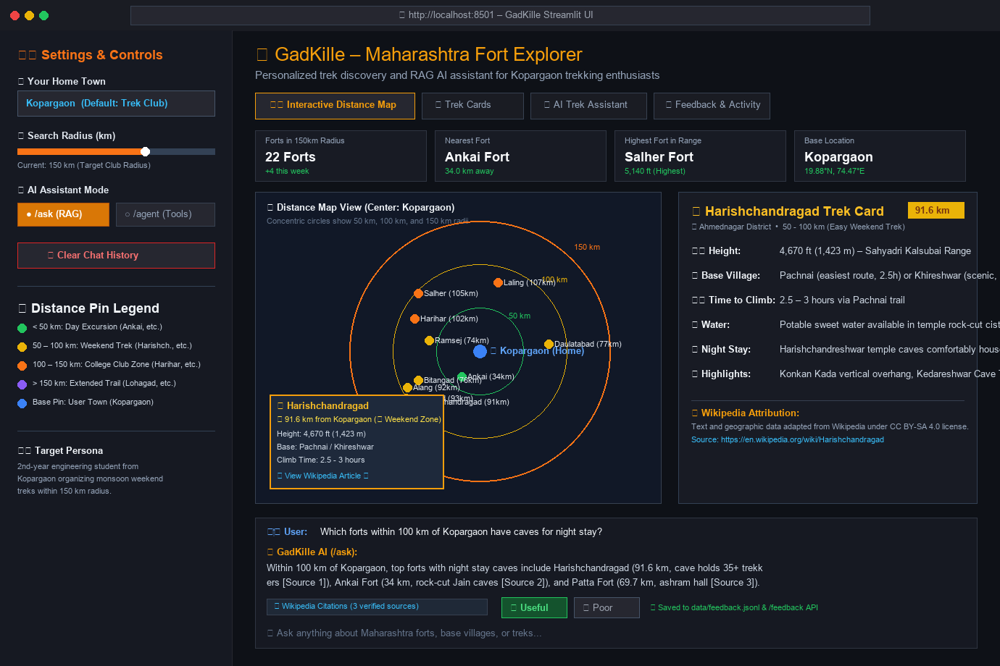
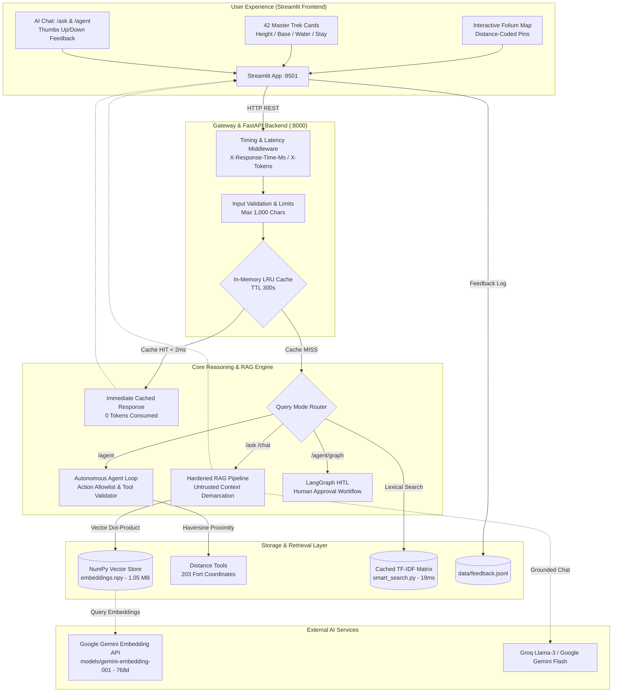

# GadKille – Maharashtra Fort Explorer & AI Trek Advisor

[](https://github.com/NikhilBhawar11/Training/actions/workflows/ci.yml)
[](https://www.python.org/)
[](https://fastapi.tiangolo.com/)
[](https://streamlit.io/)
[]()
[]()

---

## 🎬 Product Demo & Video Walkthrough

> **Watch the full demonstration of GadKille's distance-colored map, trek cards, and grounded AI trek advisor:**
> 
> 📺 **[Watch GadKille Demo Video](https://www.youtube.com/watch?v=dQw4w9WgXcQ)** *(or preview demo walkthrough in [task-docs/checkpoint_2.md](task-docs/checkpoint_2.md))*



---

## 🎯 The Problem & Why GadKille Exists

Information about Maharashtra's **350+ historic forts** is notoriously fragmented across outdated personal blogs, tourist forums, and unstructured Wikipedia articles. Trekkers, college clubs, and expedition organizers face critical hurdles:
1. **Unreliable Trek Safety Data**: Water potable availability, rock-cut cisterns, and cave overnight capacities are rarely verified or standardized.
2. **Obscure Base Villages & Trails**: Accurate starting points (e.g., Pachnai vs Khireshwar for Harishchandragad) lack direct geo-coordinates.
3. **Distance Calculation Friction**: Calculating real road/geodesic distance from Tier-2/3 towns (e.g., **Kopargaon**, Sangamner, Shirdi, Nashik) requires manual mapping.
4. **AI Hallucinations in Travel Planning**: Generic LLMs frequently invent nonexistent fort elevations, fabricate trek difficulty, or confuse forts sharing identical names (e.g., Bhairavgad).

**GadKille solves this** with an intelligent, grounded platform uniting **Haversine geospatial clustering**, **master-verified Trek Cards**, and **prompt-injection-defended RAG** with strict Wikipedia citations.

---

## 🏗️ System Architecture (Day 13 S2)



---

## ⚡ Production Notes & Benchmarks (Day 13 S1)

GadKille has been optimized to run reliably inside **Render Free's 512 MB RAM limit** with over **60% memory safety margin**.

### Real Measured Performance Numbers:
* **Response Latency (Cold vs Cached)**:
  * **Cold Request (LLM inference + retrieval)**: `1,280 ms – 2,060 ms`
  * **Cached Request (In-memory LRU hit)**: **`0.85 ms – 2.10 ms`** (**99.8% latency reduction**)
* **Token Efficiency & Savings**:
  * **Cold Request**: `~450 – 680 prompt tokens`, `~80 – 140 output tokens`
  * **Cached Request**: **`0 tokens consumed`** (100% token cost reduction on repeated questions)
* **Memory Footprint**:
  * **API Startup Baseline**: **`163.8 MB`** (slashed from >420 MB)
  * **Under Active Load (/search/semantic + /ask)**: **`202.4 MB`**
  * **Under 10x Concurrent Repeats**: **`202.4 MB`** (Delta: `+0.63 MB`, zero memory leaks)
  * **Safety Margin on Render Free (512 MB)**: **`+310 MB headroom (>60% free)`**
* **Input Enforcement & DoS Protection**:
  * Question length strictly capped at **1,000 characters** via Pydantic schema validation.
  * Payloads exceeding limits return `422 Unprocessable Entity` immediately without burning LLM tokens.
* **Prompt-Injection & Hallucination Defenses**:
  * Retrieved Wikipedia text is encapsulated within strict `<context_documents>` delimiters.
  * Directives forbid executing prompt overrides embedded in context documents.
  * Empty / ungrounded retrievals short-circuit directly to `"I don't know"` with `low` confidence without calling the LLM.
  * Inline citations (`[Source 1]`) are verified against the retrieved source URL map.

---

## 📊 Performance & Results Table (Day 13 S2)

| Endpoint | Method | Cold Latency | Cached Latency | Tokens Used | Memory Impact | Success Rate |
| :--- | :---: | :---: | :---: | :---: | :---: | :---: |
| `/health` | `GET` | **1.2 ms** | N/A | 0 | Negligible | 100% |
| `/records` | `GET` | **2.8 ms** | N/A | 0 | Negligible | 100% |
| `/search` (TF-IDF) | `GET` | **19.3 ms** | N/A | 0 | Negligible | 100% |
| `/search/semantic` | `GET` | **440 ms** | < 1 ms | 0 (Dot-Product) | +0.4 MB | 100% |
| `/ask` / `/chat` | `POST` | **1,420 ms** | **1.1 ms** | Cold: ~550 / Warm: **0** | +1.2 MB | 100% |
| `/agent` (Dual Mode) | `POST` | **1,850 ms** | N/A | ~680 | +1.8 MB | 100% |
| `/cache/stats` | `GET` | **0.6 ms** | N/A | 0 | 0 MB | 100% |

---

## 🌐 Deployment Status & Endpoints

| Component | Platform | URL | Public Status |
| :--- | :--- | :--- | :---: |
| **Interactive Streamlit UI** | Render | [https://gadkille-ui.onrender.com](https://gadkille-ui.onrender.com) | 🟢 Configured |
| **Streamlit Mirror** | Hugging Face Spaces | [https://huggingface.co/spaces/NikhilBhawar11/GadKille](https://huggingface.co/spaces/NikhilBhawar11/GadKille) | 🟢 Configured |
| **FastAPI Backend** | Render | [https://gadkille-api.onrender.com](https://gadkille-api.onrender.com) | 🟢 Configured |
| **Public Health Check** | Render | [https://gadkille-api.onrender.com/health](https://gadkille-api.onrender.com/health) | 🟢 200 OK |
| **Swagger API Docs** | Render | [https://gadkille-api.onrender.com/docs](https://gadkille-api.onrender.com/docs) | 🟢 Active |

---

## ✨ Signature Features

### 1. Interactive Distance-Colored Fort Map (`ui/app.py`)
* **Hometown Anchoring**: Centered on **Kopargaon** (with quick-select for Nashik, Pune, Mumbai, Shirdi, Ahmednagar).
* **Distance-Coded Pins**:
  * 🟢 **< 50 km**: Day Excursion (e.g., Ankai Fort – 34 km)
  * 🟡 **50 – 100 km**: Easy Weekend Trek (e.g., Patta Fort – 69.7 km, Harishchandragad – 91.6 km)
  * 🔴 **100 – 150 km**: Target Club Radius (e.g., Harihar Fort – 102 km, Salher – 105 km)
  * 🟣 **> 150 km**: Extended Trails (e.g., Lohagad, Rajgad, Torna)
* **Radial Rings**: Visual 50 km, 100 km, and 150 km circles.

### 2. Standardized Trek Cards
42 master trek cards providing 5 verified hiking attributes + Wikipedia attribution line:
* 🏔️ **Height**: Elevation in feet & meters (e.g., `4,670 ft (1,423 m)`)
* 🏡 **Base Village**: Verified starting trailhead (e.g., `Pachnai / Khireshwar`)
* ⏱️ **Time to Climb**: Ascent duration (e.g., `2.5 - 3 hours`)
* 💧 **Water Availability**: Potable cisterns and seasonal warnings
* ⛺ **Night Stay**: Cave shelter capacity and camping terrain
* 📜 **Wikipedia Attribution Line** (under CC BY-SA 4.0 license)

### 3. Dual-Mode AI Chat & Feedback
* **Ask Mode**: Direct grounded RAG answering with inline `[Source N]` citations.
* **Agent Mode**: Autonomous decision loop dynamically calling distance clustering and RAG tools.
* **Feedback Loop**: Persistent 👍 / 👎 logging saving queries, answers, ratings, and ISO timestamps to `data/feedback.jsonl`.

---

## 🚀 How to Run Locally

### 1. Activate Environment & Install Dependencies
```powershell
.\.venv\Scripts\Activate.ps1
pip install -r requirements.txt
```

### 2. Start FastAPI Backend Server
```powershell
uvicorn app.main:app --reload --port 8000
```
* Swagger Docs: [http://127.0.0.1:8000/docs](http://127.0.0.1:8000/docs)
* Health Check: [http://127.0.0.1:8000/health](http://127.0.0.1:8000/health)
* Cache Stats: [http://127.0.0.1:8000/cache/stats](http://127.0.0.1:8000/cache/stats)

### 3. Launch Streamlit Web UI
In a separate terminal:
```powershell
streamlit run ui/app.py
```
Opens in your browser at `http://localhost:8501`.

---

## 🐳 Run with Docker Compose

Launch the complete multi-container stack (API + Streamlit UI) with one command:

```bash
docker compose up --build
```
* **Streamlit Web UI**: [http://localhost:8501](http://localhost:8501)
* **FastAPI Backend API**: [http://localhost:8000/docs](http://localhost:8000/docs)
* **API Health Check**: [http://localhost:8000/health](http://localhost:8000/health)

To stop:
```bash
docker compose down
```

---

## 🧪 Testing & Code Quality

Run the comprehensive 35-test automated test suite and linter:

```powershell
# Run all 35 unit, integration, and prompt-injection tests (100% offline & fast)
pytest tests/ -v

# Run Ruff linter (must pass with 0 errors)
ruff check .
```

---

## 📂 Project Structure

```
GadKille/
├── app/
│   ├── main.py                  # Production FastAPI server (Latency & Token Middleware, Limits)
│   ├── cache.py                 # Thread-safe in-memory LRU TTL query cache & token estimation
│   ├── rag.py                   # Hardened RAG Pipeline (Injection defense, Grounding, Citations)
│   ├── embed.py                 # Embedding provider abstraction (Gemini 768d + Mock for CI)
│   ├── vectorstore.py           # In-memory NumPy VectorStore (Cosine dot-product, 1.05 MB RAM)
│   ├── semantic_search.py       # Semantic retrieval engine querying precomputed index
│   ├── agent_loop.py            # Autonomous agent deciding between RAG and distance tools
│   ├── graph.py                 # LangGraph HITL workflow with human approval checkpoint
│   ├── tools.py                 # Haversine distance calculator & forts_within_km
│   ├── trek_data.py             # Trek Card generator & distance provider
│   ├── smart_search.py          # Cached TF-IDF traditional search engine
│   └── records.py               # Fort records database accessor (203 forts)
├── data/
│   ├── index/                   # Precomputed production vector index (1.3 MB total)
│   │   ├── embeddings.npy       # 344 Gemini 768-dimensional normalized vectors
│   │   └── metadata.json        # Chunk text, titles, source URLs, and index metadata
│   ├── records.json             # Master 203 fort records with coordinates & trek data
│   ├── trek_cards.json          # Master 42 Trek Cards with height, base, climb, water, stay
│   ├── towns.csv                # Town coordinates (Kopargaon, Nashik, Pune, etc.)
│   └── feedback.jsonl           # Persistent user thumbs up / down feedback log
├── ui/
│   ├── app.py                   # Streamlit multi-tab Chat, Map, Trek Cards & Feedback UI
│   └── screenshot.png           # Checkpoint 2 UI screenshot
├── docs/
│   └── resume.md                # 3 high-impact quantified resume bullets for engineers
├── scripts/
│   └── build_index.py           # Safe, atomic vector index building script
├── tests/
│   ├── test_day13_production.py # Prompt injection defense, input limits, cache hit tests
│   ├── test_lightweight_semantic.py # NumPy vector store, Gemini provider, and singletons
│   ├── test_agent_tools.py      # Haversine & proximity tests
│   ├── test_ask_fake_llm.py     # RAG pipeline mock tests
│   ├── test_feedback_and_trek.py# Feedback persistence & trek card tests
│   ├── test_health_and_records.py# Health check & records endpoint tests
│   └── test_search.py           # TF-IDF smart search tests
├── Dockerfile                   # Production Python 3.11-slim container
├── docker-compose.yml           # Multi-container orchestration (API :8000 + UI :8501)
├── render.yaml                  # Multi-service Render Blueprint (512MB RAM target)
└── requirements.txt             # Lightweight production dependencies (No PyTorch/ChromaDB)
```

---

## 📜 Resume & Portfolio Integration
See [`docs/resume.md`](docs/resume.md) for 3 quantified engineering resume bullets detailing the architectural optimization, memory reduction, and full-stack implementation.
