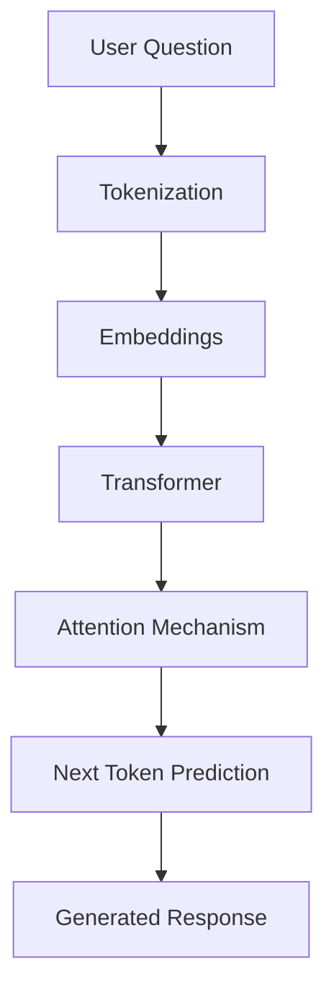

# How LLMs Work

## 1. What is an LLM?

LLM stands for Large Language Model. It is an AI model trained on a large amount of text data so that it can understand and generate human-like language.

Examples include GPT, Gemini, and Llama.

An LLM can answer questions, summarize information, generate code, translate languages, and explain concepts.

## 2. How does an LLM work?

An LLM generally works through the following steps:

1. **Input:** The user enters a question or prompt.
2. **Tokenization:** The text is divided into smaller units called tokens.
3. **Embedding:** Tokens are converted into numerical representations that the model can process.
4. **Transformer:** The transformer architecture uses attention mechanisms to understand relationships between tokens and their context.
5. **Prediction:** The model predicts the next token based on the previous context.
6. **Output:** Predicted tokens are combined to generate the final response.

## 3. LLM Working Diagram

## 4. What is a Transformer?

A Transformer is a deep learning architecture used in modern LLMs.

Its important component is the self-attention mechanism. It helps the model understand which words are important in relation to other words in a sentence.

For example:

"The fort is located near the village."

The model uses context to understand the relationship between the fort and the village.

## 5. What is Tokenization?

Tokenization is the process of splitting text into smaller units called tokens.

For example:

"Explore Maharashtra forts"

The tokenizer may divide this sentence into individual words or smaller subword units.

## 6. What is Attention?

Attention helps the model focus on relevant parts of the input while processing a sentence.

It helps understand context instead of treating every word independently.

## 7. How does GadKille use this concept?

GadKille is a Maharashtra forts explorer.

A future LLM-powered version of GadKille could:

- Understand questions about Maharashtra forts.
- Retrieve relevant fort information from the dataset.
- Generate simple and understandable answers.
- Explain fort history and trekking information.

For example, a user might ask:

"Tell me about Raigad Fort."

The application could retrieve relevant information and use an LLM to generate a natural-language answer.

**Important:** An LLM does not automatically know the latest or complete information about every fort. GadKille should use its actual dataset as a source of information and avoid generating unsupported answers.
## 8. Real User Questions for GadKille

1. Which forts are located in Maharashtra?
2. Tell me about Raigad Fort and its history.
3. Where is Sinhagad Fort located?
4. What is the height of Shivneri Fort?
5. How difficult is the trek to Rajgad Fort?
6. Is Harihar Fort open for trekking tomorrow, or is it closed by the forest department?
7. Which forts are located in Ahmednagar district?
8. What is the height of Pratapgad Fort?
9. Which village is the base village for Torna Fort?
10. Which forts are suitable for beginner trekkers?

**Note:** Q6 cannot be answered using the current GadKille dataset because it does not contain live trekking permissions or forest department updates.

## 9. Conclusion

LLMs combine tokenization, embeddings, transformer architecture, attention, and next-token prediction to generate human-like responses. They can make GadKille more interactive by allowing users to ask questions in natural language.

## 8. Conclusion

LLMs combine tokenization, embeddings, transformer architecture, attention, and next-token prediction to generate human-like responses. They can make GadKille more interactive by allowing users to ask questions in natural language.